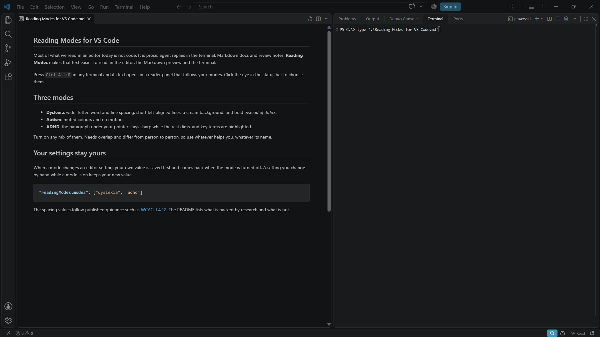

# Reading Modes for VS Code

Dyslexia, autism and ADHD reading modes for VS Code: the editor, the Markdown preview and the terminal.
The modes draw on published reading guidance for each group. Needs overlap and differ from person to person,
so turn on whichever modes help you, whatever their name.

## Use

- Click the eye in the status bar (or run "Reading Modes: Choose Modes") and tick the modes you want.
- Terminal: press Ctrl+Alt+R in the terminal, or the book icon in the terminal panel title,
  to open its text in a reader panel styled by your modes. `r` refreshes, `gg`/`G` jump to top/bottom.
- Editor: select text and press Ctrl+Alt+R (or right-click, "Read Selection").
- The Markdown preview follows your modes automatically.

## What each mode changes

| Mode | Reader panel and Markdown preview | The rest of VS Code |
|------|-----------------------------------|---------------------|
| Dyslexia | letter spacing 0.12em, word spacing 0.42em, line height 1.8, lines of about 68 characters, left-aligned, bold instead of italics, cream background, Atkinson Hyperlegible | wider terminal letter spacing; Markdown and plain text: wider letter spacing and line height, reading font, wrap at 68 |
| Autism | muted colours | reduce motion, no cursor blink, no smooth scrolling |
| ADHD | the hovered block stays sharp and the rest dims, bold terms highlighted, reading progress bar | Markdown and plain text: every paragraph except the cursor's is dimmed |

With any mode on, links in the reader and preview are underlined and nothing animates.

Settings are written to your user settings. Your own values are saved and come back when the
mode is turned off; a setting you change by hand while a mode is on keeps your new value.

Run "Reading Modes: Turn All Modes Off" before uninstalling, or the changed settings stay.

## What the evidence says

Not everything here is equally well supported. In short:

- **Spacing** has the best evidence. Extra letter spacing reduced reading errors for children with dyslexia
  ([Zorzi et al. 2012](https://pmc.ncbi.nlm.nih.gov/articles/PMC3396504/)). The values follow
  [WCAG 1.4.12](https://www.w3.org/WAI/WCAG22/Understanding/text-spacing.html) for letter spacing and the
  British Dyslexia Association style guide for word spacing (about 3.5 times the letter spacing).
- **Short left-aligned lines, no italics, a cream background** follow the British Dyslexia Association style guide,
  [WCAG 1.4.8](https://www.w3.org/WAI/WCAG22/Understanding/visual-presentation.html) and the
  [UK Home Office posters](https://accessibility.blog.gov.uk/2016/09/02/dos-and-donts-on-designing-for-accessibility/).
  Research on background colour is mixed.
- **Atkinson Hyperlegible** is a legibility font designed for low vision. It has not been tested as a dyslexia aid,
  and trials of specialist "dyslexia fonts" found no benefit over plain sans-serif fonts
  ([Kuster et al. 2018](https://www.ncbi.nlm.nih.gov/pmc/articles/PMC5934461/)). It is here because it is clear,
  not because it is proven to help.
- **Calm colours and no motion** follow the UK Home Office guidance and the W3C
  [cognitive accessibility guidance](https://www.w3.org/TR/coga-usable/design_guide.html). Preferences vary a lot.
- **Paragraph dimming and the progress bar** are untested conveniences; I know of no study on them. Dimmed text stays
  at 70% opacity, which keeps a 4.5:1 contrast on the cream and calm backgrounds and on VS Code's default themes.

## Limits

- The terminal grid has one font and spacing for every line, so the full reading styles are in
  the reader panel, not the terminal itself.
- Reading the terminal copies it through the clipboard and puts your clipboard text back.
  An image on the clipboard is lost.
- The editor uses Atkinson Hyperlegible only if it is installed on your system; otherwise Verdana.

## Build

    npm install
    npm run package   # typecheck, tests, bundle, reading-modes-<version>.vsix
    code --install-extension reading-modes-<version>.vsix
